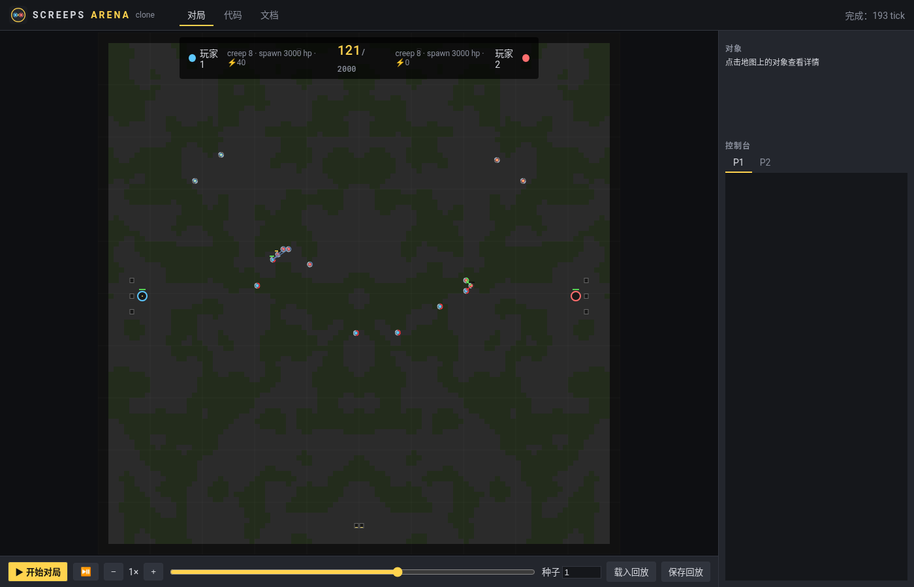

<p align="center"></p>

# Screeps Arena Clone

开源的 **Screeps Arena** 复刻：按官方 [API 文档](https://arena.screeps.com/docs) 的模块、原型类、常量与返回码实现的**确定性对局引擎**，加上一个仿 Arena 风格的浏览器对局 / 回放客户端。

> 非官方项目，与 Screeps / Screeps Arena 及其开发商无关。图标为原创设计，仅风格上致敬。



## 快速开始
```bash
npm test                 # 引擎规则测试（零依赖，Node ≥ 20）
npm run match            # 命令行跑一局：bots/rush.mjs vs bots/kite.mjs
npm start                # 打开 http://localhost:8080/web/ ，在「代码」页编辑两方脚本，「对局」页点 ▶ 开始对局
```

## 写法与官方一致
```js
import { getObjectsByPrototype } from 'game/utils';
import { Creep, StructureSpawn } from 'game/prototypes';
import { ATTACK, MOVE, ERR_NOT_IN_RANGE } from 'game/constants';

export function loop() {
  const spawn = getObjectsByPrototype(StructureSpawn).find(s => s.my);
  spawn.spawnCreep([ATTACK, MOVE]);
  const enemy = getObjectsByPrototype(StructureSpawn).find(s => !s.my);
  for (const c of getObjectsByPrototype(Creep).filter(c => c.my))
    if (c.attack(enemy) === ERR_NOT_IN_RANGE) c.moveTo(enemy);
}
```
已实现的 API 见 [docs/API.md](docs/API.md)。

## 当前模式：Spawn and Swamp（基础版）
- 100×100 地图、大片沼泽、左右镜像对称；双方各一个 Spawn（初始 500 能量）+ 3 个家门口容器。
- 每 50 tick 在中场镜像刷出一对带能量的中立容器。
- 摧毁对方 Spawn 获胜；2000 tick 未分胜负判平局。
- 地图生成与容器刷新规律是近似实现（官方未公开），所有数值规则来自官方常量。

## 结构
```
src/constants.js         game/constants（官方文档逐项取值）
src/engine/prototypes.js game/prototypes：GameObject/Creep/Structure*/Source/Resource/ConstructionSite/Flag/Store/Spawning
src/engine/pathfinder.js game/path-finder：CostMatrix + searchPath（A*，官方默认参数）
src/engine/world.js      确定性 tick 结算：战斗 → 经济 → 移动(含 pull、对换、冲突) → 死亡/生产/衰减 → 模式规则；回放快照
src/engine/sandbox.js    玩家 ES 模块改写与执行、game/visual、arenaInfo
src/modes/               对局模式（spawnAndSwamp）
web/                     浏览器客户端：Web Worker 跑模拟 → Canvas 回放（逐 tick 插值、事件连线、对象检查器、控制台、回放存取）
bots/                    示例 AI
test/                    规则测试
```

## 与 Screeps World（screeps-blockly-mobile）的关系
沿用同一套思路：原生 JS、引擎与渲染分离、引擎可在 Node 跑测试、常量照搬官方。后续可共用渲染风格、Blockly 积木层和局域网对战协议。

## 路线图
- [ ] Capture the Flag、Spawn and Swamp 高级版（Source/建造/Extension/Tower）、Collect and Control 等模式
- [ ] 每 tick CPU 限时（cpuTimeLimit 50ms / 首 tick 1000ms）与更强的沙盒隔离
- [ ] 代码编辑器（Monaco/CodeMirror）+ 类型提示；Blockly 积木模式
- [ ] 联机对战 / 天梯、PixiJS 渲染与更贴近官方的美术
- [ ] 与官方行为逐条对照测试（移动冲突、rampart、疲劳等边界情况）
