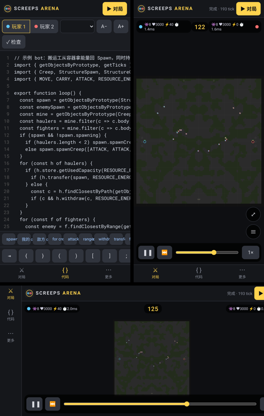

<p align="center"></p>

# Screeps Arena Clone

开源的 **Screeps Arena** 复刻：按官方 [API 文档](https://arena.screeps.com/docs) 的模块、原型类、常量与返回码实现的**确定性对局引擎**，加上一个仿 Arena 风格的浏览器对局 / 回放客户端。

> 非官方项目，与 Screeps / Screeps Arena 及其开发商无关。图标为原创设计，仅风格上致敬。

**安卓手机游戏**（Capacitor 6），竖屏/横屏均可。下载：[Releases](../../releases/latest) 里的 `screeps-arena-v*.apk`；应用启动时会自动检查新版本并在应用内更新。



## 开发
```bash
npm ci && npm test       # 引擎规则 + 沙盒测试
npm run match            # 命令行跑一局：bots/rush.mjs vs bots/kite.mjs
./scripts/prepare.sh && npm start   # 浏览器调试移动端界面：http://localhost:8080/www/
```

## 打包安卓
```bash
APP_VERSION=0.2.0 VERSION_CODE=20 ./scripts/build-android.sh   # JDK17 / Android SDK 默认取 ~/sdk
./scripts/sign.sh screeps-arena-v0.2.0.apk                      # 签名信息来自环境变量或本地 keystore.properties（已 gitignore）
```
`keystore.properties` 示例（不要提交）：`storeFile=~/keys/release.p12` / `storePassword=…` / `keyAlias=release`。

## 移动端界面
- 底部导航（横屏时变为左侧竖栏）：对局 / 代码 / 更多。
- 地图：双指缩放、单指拖动、点对象弹出详情面板；回放控制条（播放/单步/倍速/拖动）、P1/P2 控制台。
- 代码编辑器：行号、自动缩进、符号快捷键条、常用 API 代码片段、字号调节、提交前语法检查、示例模板。

## 沙盒与 CPU 限制
- 每 tick `cpuTimeLimit` 50 ms，首 tick `cpuTimeLimitFirstTick` 1000 ms（官方值）。用 acorn 解析脚本，在每个循环体和函数入口插入检查点；超时即中止该 tick，并作废该玩家本 tick 的全部指令。
- 脚本以严格模式运行在独立 Worker 里；`globalThis/self/window/fetch/XMLHttpRequest/WebSocket/importScripts/localStorage/document…` 均被遮蔽，Worker 内网络能力被删除，`eval` 与所有 `Function` 构造器在编译后被封死。
- 主线程看门狗：Worker 15 s 无进度直接终止。Node 命令行在独立 vm realm 中运行，并对每 tick 加硬超时。

## 写法与官方一致
```js
import { getObjectsByPrototype } from 'game/utils';
import { Creep, StructureSpawn } from 'game/prototypes';
import { ATTACK, MOVE, ERR_NOT_IN_RANGE } from 'game/constants';

export function loop() {
  const spawn = getObjectsByPrototype(StructureSpawn).find(s => s.my);
  spawn.spawnCreep([ATTACK, MOVE]);
  const enemy = getObjectsByPrototype(StructureSpawn).find(s => !s.my);
  for (const c of getObjectsByPrototype(Creep).filter(c => c.my))
    if (c.attack(enemy) === ERR_NOT_IN_RANGE) c.moveTo(enemy);
}
```
已实现的 API 见 [docs/API.md](docs/API.md)。

## 当前模式：Spawn and Swamp（基础版）
- 100×100 地图、大片沼泽、左右镜像对称；双方各一个 Spawn（初始 500 能量）+ 3 个家门口容器。
- 每 50 tick 在中场镜像刷出一对带能量的中立容器。
- 摧毁对方 Spawn 获胜；2000 tick 未分胜负判平局。
- 地图生成与容器刷新规律是近似实现（官方未公开），所有数值规则来自官方常量。

## 结构
```
src/constants.js         game/constants（官方文档逐项取值）
src/engine/prototypes.js game/prototypes：GameObject/Creep/Structure*/Source/Resource/ConstructionSite/Flag/Store/Spawning
src/engine/pathfinder.js game/path-finder：CostMatrix + searchPath（A*，官方默认参数）
src/engine/world.js      确定性 tick 结算：战斗 → 经济 → 移动(含 pull、对换、冲突) → 死亡/生产/衰减 → 模式规则；回放快照
src/engine/sandbox.js    玩家 ES 模块改写与执行、game/visual、arenaInfo
src/modes/               对局模式（spawnAndSwamp）
www/                     移动端客户端（Capacitor webDir）：Worker 跑模拟 → Canvas 回放，触控缩放/拖动、编辑器、应用内更新
plugins/capacitor-app-updater  应用内更新插件（改自 screeps-blockly-mobile 的 AppUpdater）
android-res/             启动图标（scripts/gen-icons.py 生成）
bots/                    示例 AI
test/                    规则测试
```

## 与 Screeps World（screeps-blockly-mobile）的关系
沿用同一套思路：原生 JS、引擎与渲染分离、引擎可在 Node 跑测试、常量照搬官方。后续可共用渲染风格、Blockly 积木层和局域网对战协议。

## 路线图
- [ ] Capture the Flag、Spawn and Swamp 高级版（Source/建造/Extension/Tower）、Collect and Control 等模式
- [ ] 代码补全/语法高亮；Blockly 积木模式（复用 screeps-blockly-mobile 的方案）
- [ ] 联机对战 / 天梯、PixiJS 渲染与更贴近官方的美术
- [ ] 与官方行为逐条对照测试（移动冲突、rampart、疲劳等边界情况）
